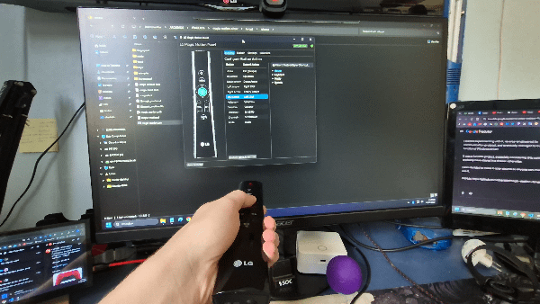
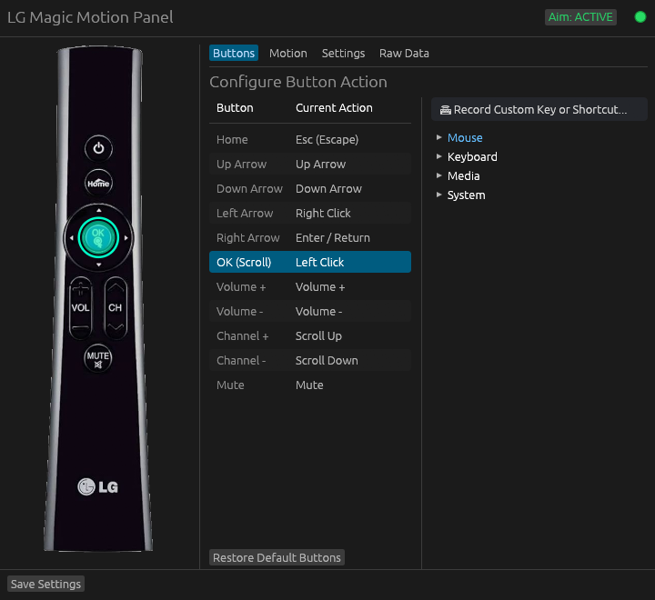
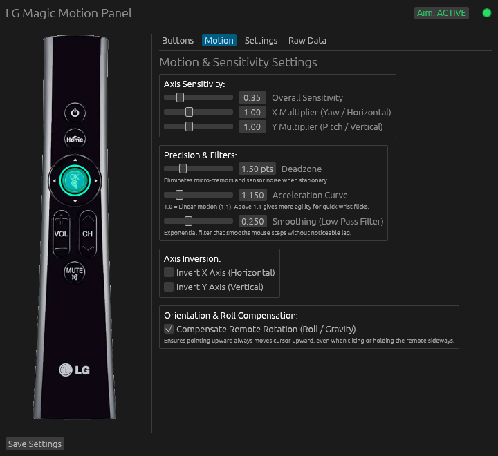
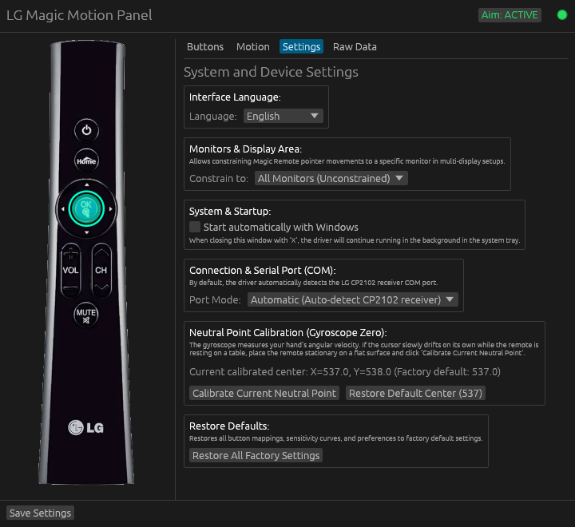
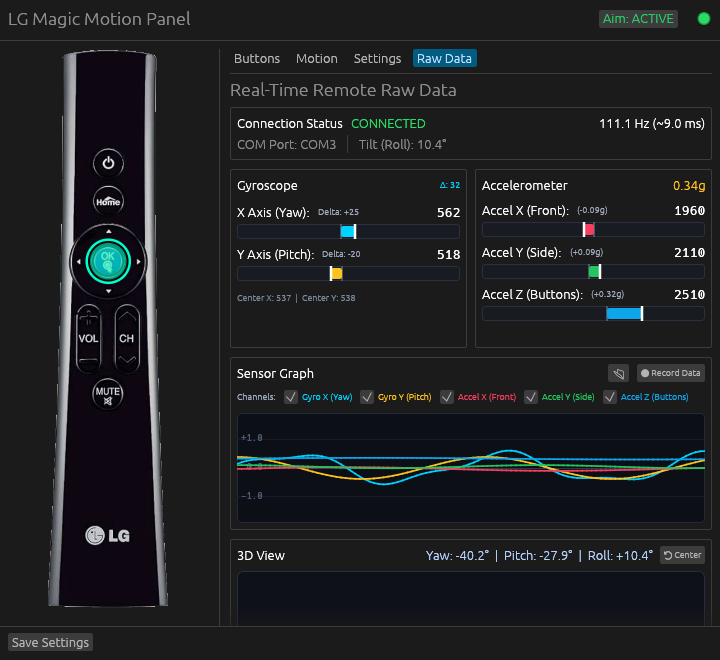
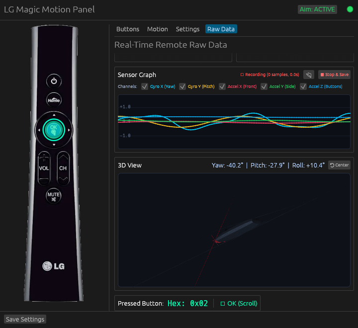

<div align="center">

# LG Magic Motion Driver

**User-mode Windows air-mouse driver, button remapper, and real-time 3D IMU telemetry studio for the LG Magic Motion Remote (`AN-MR200` / `AN-MR100`).**

[](https://github.com/obertobr/magic-motion-driver/releases)
[-orange?style=flat-square&logo=rust)](https://www.rust-lang.org/)
[](https://github.com/obertobr/magic-motion-driver)
[](LICENSE)
[](https://github.com/obertobr/magic-motion-driver/actions)

<br />



</div>

---

## Overview

**LG Magic Motion Driver** brings the **LG AN-MR200 / AN-MR100 Magic Motion TV Remote** and its accompanying USB RF dongle (`Silicon Labs CP2102`) to Windows as a high-precision, zero-latency **6-DOF Air Mouse** and customizable **Macro / Media Controller**.

Built from the ground up in **100% Rust** following **Hexagonal (Clean) Architecture**, the driver decodes the proprietary 111 Hz RF UART stream directly in user mode and dispatches native Windows input events via `SendInput`.

---

## Key Features

- **⚡ Native 111 Hz RF Stream Engine**
  - Lock-free state-machine decoder for the 17-byte `115200 8-N-1` serial protocol with automatic frame resynchronization and checksum verification.
  - Automatic USB discovery and hot-plug reconnection for Silicon Labs `CP210x` receivers (`VID 0x10C4`, `PID 0xEA60`).
- **🧭 Roll-Compensated Air Mouse**
  - Uses the 3-axis accelerometer to track the gravity vector in real time and derotate the 2-axis gyroscope angular velocity into screen coordinates.
  - Pointing the remote upward **always** moves the cursor toward the top of your monitor—even if your wrist is tilted sideways or upside down.
  - Dynamic **trust-factor weighting** rejects linear hand acceleration during fast flicks and suppresses cursor jumps when clicking physical buttons.
  - Sub-pixel remainder accumulation, configurable deadzone, non-linear acceleration curve, and exponential low-pass smoothing.
- **🎛️ Interactive Visual Button Remapper**
  - Live visual highlight on the `AN-MR200` remote diagram whenever a physical button is pressed.
  - Map any button to **Mouse Clicks**, **Scroll Wheel**, **Media Transport**, **System Volume**, **Keyboard Navigation**, **Window Management**, or record **Custom Multi-Key Shortcuts** (`Ctrl + Alt + Shift + ...`).
- **📊 Real-Time IMU Telemetry & 3D Attitude Studio**
  - Live connection diagnostics (`COM` port, packet rate in `Hz`, roll tilt angle).
  - Bipolar gyroscope (`Yaw` / `Pitch`) and calibrated accelerometer (`g`-force) bars.
  - **5-Channel Oscilloscope** (`Gyro X`, `Gyro Y`, `Accel X`, `Accel Y`, `Accel Z`) with per-channel toggles.
  - **Singularity-Free 3D View** powered by a **Direction Cosine Matrix (DCM)** complementary filter on $SO(3)$ with zero gimbal lock.
  - **111 Hz CSV Sensor Recorder** with hardware frame timestamps for signal processing and machine learning analysis.
- **🖥️ Multi-Monitor & System Tray Integration**
  - Constrain pointer movement to a specific display in multi-monitor setups or roam freely across the entire virtual desktop.
  - Runs silently in the Windows System Tray with live connection status icons, quick aim toggle, and optional **Start with Windows** (`HKCU\...\Run`).
- **🌐 Internationalization (`en-US` & `pt-BR`)**
  - Automatic Windows UI language detection on first launch, with instant switching between **English** and **Português (Brasil)**.

---

## Screenshots

### 1. Interactive Button Remapping (`Buttons`)
Press any physical button on the remote—or click its hotspot on the interactive diagram—to assign mouse actions, media controls, or custom keyboard shortcuts.

<div align="center">
  
</div>

### 2. Air-Mouse Kinematics & Filters (`Motion`)
Fine-tune overall sensitivity, independent X/Y multipliers, stationary deadzone, wrist-flick acceleration curve, low-pass smoothing, and gravity-based roll compensation.

<div align="center">
  
</div>

### 3. System, Multi-Monitor & Gyro Calibration (`Settings`)
Switch interface language, lock the pointer to a target monitor, enable Windows startup auto-run, select the serial port mode, or calibrate the gyroscope neutral center.

<div align="center">
  
</div>

### 4. Real-Time Telemetry, Oscilloscope & 3D Orientation (`Raw Data`)
Inspect raw 111 Hz sensor readings, visualize all 5 IMU channels in real time, record lossless CSV datasets, and observe the remote's 3D spatial attitude.

<div align="center">
  
  <br /><br />
  
</div>

---

## Hardware Requirements

| Component | Details |
|---|---|
| **Remote Control** | LG Magic Motion **AN-MR200** (or compatible **AN-MR100** RF remotes) |
| **USB RF Receiver** | LG RF Dongle based on **Silicon Labs CP2102 USB to UART Bridge** (`VID_10C4&PID_EA60`) |
| **USB Driver** | [Silicon Labs CP210x VCP Windows Driver](https://www.silabs.com/developers/usb-to-uart-bridge-vcp-drivers) (`silabser.sys`, usually installed automatically via Windows Update) |
| **Operating System** | Windows 10 or Windows 11 (`x64`, `x86 32-bit`, `ARM64`) |

---

## Getting Started

### Option 1: Download Pre-Built Binary
1. Download the executable for your architecture (`magic-motion-windows-x64.exe`, `x86.exe`, or `arm64.exe`) from the [**Releases**](https://github.com/obertobr/magic-motion-driver/releases) page.
2. Plug in the LG RF USB receiver.
3. Run `magic-motion.exe`.

### Option 2: Build from Source
Ensure you have [Rust 1.85+](https://rustup.rs/) installed on Windows:

```powershell
git clone https://github.com/obertobr/magic-motion-driver.git
cd magic-motion-driver
cargo build --release
```

The optimized standalone executable will be generated at:
```text
target\release\magic-motion.exe
```

### Command-Line Options

By default, launching `magic-motion.exe` with no arguments opens the GUI Control Panel and starts the background driver thread.

| Argument | Description |
|---|---|
| *(none)* or `--gui` | Launch the desktop Control Panel and System Tray icon |
| `--minimized` | Start silently in the Windows System Tray (used by Windows Startup) |
| `--headless` | Run the driver in console-only mode without the GUI |
| `--port <COMx>` | Override automatic `CP2102` discovery and force a specific serial port (e.g. `--port COM4`) |
| `--calibrate` | Run a 3-second CLI gyroscope neutral-center calibration and save to `config.toml` |
| `--dump` | Print decoded 111 Hz frames to `stdout` for debugging |

---

## Architecture

The codebase is organized into three strictly separated layers:

```text
src/
├── domain/          # Pure business rules & math (zero OS / UI / I/O dependencies)
│   ├── action.rs    # Mappable actions, virtual keys, media keys & shortcuts
│   ├── attitude.rs  # 3D Direction Cosine Matrix (DCM) estimator on SO(3)
│   ├── button.rs    # Button codes, bitmask decoding & dense ButtonSet
│   ├── config.rs    # Strongly-typed configuration schema & defaults
│   ├── gravity.rs   # 3-axis accelerometer calibration & gravity roll estimation
│   ├── i18n.rs      # Supported languages & locale resolution
│   ├── motion.rs    # Roll-compensated air-mouse pipeline, deadzone & smoothing
│   └── protocol.rs  # 17-byte RF frame state-machine decoder & checksum
├── infra/           # OS & Hardware adapters
│   ├── autostart.rs # Windows Registry HKCU Run integration
│   ├── driver.rs    # High-rate 111 Hz serial worker thread & telemetry channel
│   ├── input.rs     # Win32 SendInput dispatcher & multi-monitor clamping
│   └── serial.rs    # Silicon Labs CP210x USB discovery & serial port config
└── presentation/    # Desktop GUI & System Tray (eframe / egui)
    ├── hotspots.rs  # Interactive button hitboxes over the AN-MR200 diagram
    ├── i18n.rs      # Static zero-allocation English & Portuguese UI catalogs
    ├── mesh3d.rs    # Built-in 3D remote mesh & Wavefront OBJ parser
    ├── tray.rs      # Windows System Tray icon & native context menu
    └── view.rs      # Control panel tabs, 5-ch oscilloscope & 3D viewport
```

---

## RF Serial Protocol Summary

The LG RF USB receiver exposes a `115200` baud (`8-N-1`) UART stream emitting fixed **17-byte frames** at **~111.1 Hz** while the remote is awake:

```text
+------+------+--------+--------+--------+--------+--------+--------+------+------+------+-----+
| Byte |  0   |   1    |  2..3  |  4..5  |   6    |  7..8  | 9..10  |11..12|  13  |  14  |  15 | 16  |
+------+------+--------+--------+--------+--------+--------+--------+------+------+------+-----+
| Desc | STX  |  Aux   | Gyro X | Gyro Y | Button | AccelX | AccelY |AccelZ| Link | Seq  | Cks | ETX |
| Val  | 0x02 | ~0x37  | u16 BE | u16 BE |  u8    | u16 BE | u16 BE |u16 BE| 0x01 | u8   | u8  |0x03 |
+------+------+--------+--------+--------+--------+--------+--------+------+------+------+-----+
```

- **Checksum (`Byte 15`)**: Bitwise NOT of the sum of bytes `1..=14` (`!(sum(bytes[1..=14])) & 0xFF`).
- Full reverse-engineered protocol documentation is available in [**`docs/PROTOCOL.md`**](docs/PROTOCOL.md).

---

## Running Tests

The test suite includes **56 unit and integration tests** validating protocol decoding against real hardware captures (`tests/fixtures/captured_frames.txt`), roll compensation across arbitrary 3D poses, DCM orthonormalization, and localization completeness:

```powershell
cargo test
```

---

## Contributing

Contributions, bug reports, and feature requests are welcome! Please read [**`CONTRIBUTING.md`**](CONTRIBUTING.md) for development guidelines.

## How was AI used in this project?

This project was developed with assistance from Gemini AI through Google Antigravity.

- **Protocol analysis & math**: Assisted in inspecting raw serial bytes from the RF receiver, deriving the checksum calculation, and formulating the 3D DCM filter and gravity roll compensation.
- **Code structure**: Assisted with scaffolding the hexagonal architecture in Rust and writing unit tests.
- **Win32 input research**: Assisted in researching Win32 API behaviors, such as hardware scancodes and auto-repeat handling for games.
- **Testing & validation**: All physical hardware tests, serial packet captures, and design decisions were made by the author.

## License

Distributed under the **GNU General Public License v2.0 (GPL-2.0)**. See [**`LICENSE`**](LICENSE) for more information.

